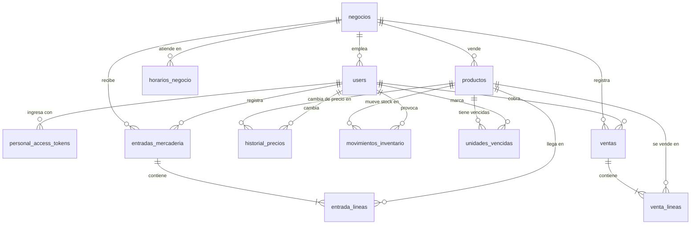

# Modelo de datos

El esquema está en tercera forma normal. Este documento describe las tablas que ya existen; cada módulo completa las suyas en el pull request que agrega su migración.

Las convenciones de nombres, llaves, fechas y dinero están en [database.md](database.md). Las tablas `productos`, `entradas_mercaderia`, `entrada_lineas`, `historial_precios`, `movimientos_inventario`, `unidades_vencidas`, `ventas`, `venta_lineas` y `horarios_negocio` tienen seguridad a nivel de fila forzada: cada transacción solo alcanza las filas de su negocio.

## Diagrama

## Tablas del negocio

### negocios

| Columna | Tipo | Detalle |
| --- | --- | --- |
| `id` | `uuid` | Llave primaria |
| `nombre` | `varchar(120)` | |
| `logo_path` | `varchar(255)` | Opcional; ruta en el disco privado, dentro de `negocios/{id}/logo/` |
| `estado` | `varchar(20)` | `activo` o `inactivo` |
| `created_at`, `updated_at` | `timestamptz` | |

### horarios_negocio

Una fila por franja de atención. Un día sin filas es un día cerrado.

| Columna | Tipo | Detalle |
| --- | --- | --- |
| `id` | `uuid` | Llave primaria |
| `negocio_id` | `uuid` | Llave foránea a `negocios` |
| `dia_semana` | `smallint` | 1 (lunes) a 7 (domingo), ISO 8601 |
| `hora_apertura`, `hora_cierre` | `time` | El cierre es posterior a la apertura |
| `created_at`, `updated_at` | `timestamptz` | |

## Tablas del inventario

### productos

| Columna | Tipo | Detalle |
| --- | --- | --- |
| `id` | `uuid` | Llave primaria |
| `negocio_id` | `uuid` | Llave foránea a `negocios` |
| `codigo` | `varchar(30)` | Único por negocio entre los productos vivos |
| `nombre` | `varchar(120)` | Con índice `(negocio_id, nombre)` |
| `categoria` | `varchar(60)` | Opcional |
| `precio_venta` | `numeric(12,2)` | Mayor que cero |
| `costo_actual` | `numeric(12,2)` | Cero o más; lo actualiza cada entrada |
| `stock` | `integer` | Cero o más |
| `es_perecedero`, `es_licor` | `boolean` | El licor exige la cédula del comprador al vender |
| `foto_path` | `varchar(255)` | Opcional; ruta en el disco privado |
| `created_at`, `updated_at` | `timestamptz` | |
| `deleted_at` | `timestamptz` | Borrado lógico |

### entradas_mercaderia y entrada_lineas

| Columna de `entradas_mercaderia` | Tipo | Detalle |
| --- | --- | --- |
| `id` | `uuid` | Llave primaria |
| `negocio_id` | `uuid` | Llave foránea a `negocios` |
| `proveedor` | `varchar(120)` | |
| `fecha` | `date` | No futura; índice `(negocio_id, fecha)` |
| `registrada_por` | `uuid` | Llave foránea a `users` |
| `created_at`, `updated_at` | `timestamptz` | |

| Columna de `entrada_lineas` | Tipo | Detalle |
| --- | --- | --- |
| `id` | `uuid` | Llave primaria |
| `negocio_id` | `uuid` | Llave foránea a `negocios` |
| `entrada_id` | `uuid` | Llave foránea a `entradas_mercaderia`, en cascada |
| `producto_id` | `uuid` | Llave foránea a `productos` |
| `cantidad` | `integer` | Mayor que cero |
| `costo_unitario` | `numeric(12,2)` | Cero o más |
| `costo_anterior` | `numeric(12,2)` | Opcional; el costo que tenía el producto antes de esta entrada |
| `created_at`, `updated_at` | `timestamptz` | |

### historial_precios

| Columna | Tipo | Detalle |
| --- | --- | --- |
| `id` | `uuid` | Llave primaria |
| `negocio_id`, `producto_id`, `usuario_id` | `uuid` | Llaves foráneas |
| `costo`, `precio_venta` | `numeric(12,2)` | Valores después del cambio |
| `motivo` | `varchar(20)` | `creacion`, `edicion`, `entrada` o `cambio_precio` |
| `referencia_id` | `uuid` | Opcional; la entrada que provocó el cambio |
| `created_at`, `updated_at` | `timestamptz` | |

### movimientos_inventario

Una fila por cada cambio del stock, para la trazabilidad.

| Columna | Tipo | Detalle |
| --- | --- | --- |
| `id` | `uuid` | Llave primaria |
| `negocio_id`, `producto_id`, `usuario_id` | `uuid` | Llaves foráneas |
| `tipo` | `varchar(20)` | `entrada`, `venta`, `anulacion`, `vencimiento` o `ajuste` |
| `cantidad` | `integer` | Unidades del movimiento, siempre positivas; el `tipo` dice si suman o restan |
| `stock_resultante` | `integer` | Cero o más |
| `referencia_id` | `uuid` | Opcional; la entrada o la venta que lo provocó |
| `created_at`, `updated_at` | `timestamptz` | |

### unidades_vencidas

| Columna | Tipo | Detalle |
| --- | --- | --- |
| `id` | `uuid` | Llave primaria |
| `negocio_id`, `producto_id`, `usuario_id` | `uuid` | Llaves foráneas |
| `cantidad` | `integer` | Mayor que cero |
| `motivo` | `varchar(200)` | |
| `estado` | `varchar(20)` | `activa` (sigue en el estante y no se vende) o `retirada` |
| `created_at`, `updated_at` | `timestamptz` | |

## Tablas de ventas

### ventas

| Columna | Tipo | Detalle |
| --- | --- | --- |
| `id` | `uuid` | Llave primaria |
| `negocio_id` | `uuid` | Llave foránea a `negocios` |
| `cajero_id` | `uuid` | Llave foránea a `users` |
| `metodo_pago` | `varchar(20)` | Por ahora solo `efectivo` |
| `estado` | `varchar(20)` | `abierta`, `cobrada` o `anulada`; índice `(negocio_id, estado, created_at)` |
| `total` | `numeric(12,2)` | Cero o más |
| `cedula_comprador` | `varchar(20)` | Opcional; obligatoria si alguna línea es de licor |
| `cobrada_at`, `anulada_at` | `timestamptz` | Opcionales |
| `created_at`, `updated_at` | `timestamptz` | |

### venta_lineas

| Columna | Tipo | Detalle |
| --- | --- | --- |
| `id` | `uuid` | Llave primaria |
| `negocio_id` | `uuid` | Llave foránea a `negocios` |
| `venta_id` | `uuid` | Llave foránea a `ventas`, en cascada |
| `producto_id` | `uuid` | Llave foránea a `productos` |
| `posicion` | `smallint` | Orden de la línea en la venta |
| `cantidad` | `integer` | Mayor que cero |
| `precio_unitario` | `numeric(12,2)` | Mayor que cero; el precio del catálogo al vender |
| `subtotal` | `numeric(12,2)` | |
| `created_at`, `updated_at` | `timestamptz` | |

## Tablas de identidad

### users

| Columna | Tipo | Detalle |
| --- | --- | --- |
| `id` | `uuid` | Llave primaria |
| `negocio_id` | `uuid` | Llave foránea a `negocios`; sin política de fila (ver database.md) |
| `nombre` | `varchar(120)` | |
| `correo` | `varchar(255)` | Único |
| `password` | `varchar(255)` | Solo el hash |
| `rol` | `varchar(20)` | `administrador`, `cajero` o `bodeguero` |
| `activo` | `boolean` | Una cuenta inactiva no inicia sesión |
| `created_at`, `updated_at` | `timestamptz` | |

### personal_access_tokens

La tabla de Sanctum: `id` (`bigint`), `tokenable_type`, `tokenable_id` (`uuid`), `name` (el dispositivo), `token` (hash SHA-256, único), `abilities`, `last_used_at`, `expires_at`, `created_at` y `updated_at`.

## Verificación de las formas normales

| Forma | Qué exige | Cómo se cumple |
| --- | --- | --- |
| Primera | Valores atómicos, sin grupos repetidos | Una fila por línea de venta, por línea de entrada y por franja del horario |
| Segunda | Ningún dato depende de una parte de la llave | Las llaves primarias son de una sola columna (`id`) |
| Tercera | Ningún dato depende de otro que no sea llave | El nombre del producto vive en `productos`, no en las líneas; «agotado» y el stock vendible no se guardan, se calculan |

## Excepciones deliberadas

| Excepción | Por qué es correcta |
| --- | --- |
| `negocio_id` se repite en `entrada_lineas` y `venta_lineas` aunque la cabecera ya lo implica | La seguridad a nivel de fila filtra cada tabla por su propia columna |
| `ventas.total` y `venta_lineas.subtotal` se guardan aunque salen de las líneas | Son el hecho histórico de lo que se cobró; el repositorio los escribe en la misma transacción que las líneas |
| La línea de venta guarda `precio_unitario` | No es un dato derivado: es a cuánto se vendió. Cambiar el precio del producto no altera ventas pasadas |
| `productos.stock` se guarda aunque sale de `movimientos_inventario` | Es la fila que se bloquea para vender: sin ella, dos cajas leerían el mismo saldo y venderían la misma unidad. Cada cambio deja su movimiento con el `stock_resultante` |
| `productos.costo_actual` repite el último costo de `entrada_lineas` | Un producto creado a mano no tiene entradas, y el historial de precios conserva cada valor |
| `entrada_lineas.costo_anterior` se guarda | Es la comparación que vio quien recibió la mercadería, aunque después cambie el costo |
| `personal_access_tokens.id` es `bigint` y no `uuid` | La tabla pertenece a Sanctum: el token tiene la forma `<id>\|<secreto>` |

## Regla para cada migración nueva

Antes de fusionar un pull request con una migración se revisa que la tabla tenga llave primaria `id`, que lleve `negocio_id` si pertenece a un negocio, que tenga la seguridad a nivel de fila habilitada y forzada con su política `<tabla>_aislamiento_negocio`, que tenga su `down()`, que no guarde valores calculables sin justificarlo aquí y que este documento quede actualizado.
